# Nobar King Akbar Anime

**Streaming anime + nonton bareng (nobar) online dengan pemutaran tersinkron dan obrolan langsung.**

Situs web lengkap: katalog anime **sub Indo** (diambil langsung dari otakudesu lewat
**wajik-anime-api** yang di-*vendor*), halaman tonton dengan pemilih server otomatis,
room nobar realtime (host mengendalikan pemutaran, semua peserta mengikuti),
chat dalam room, akun pengguna, favorit, dan riwayat tontonan.

| | |
|---|---|
| **Demo (sandbox)** | https://3000-irhefyuqda4fhazi9n5r4-24916fab.sg2.manus.computer |
| **Frontend** | Next.js 15 (App Router, Turbopack) · React 19 · Tailwind CSS v4 · hls.js · socket.io-client |
| **Backend** | Node.js + TypeScript (Express 4) · Socket.IO 4 · PostgreSQL 16 · Zod · bcryptjs |
| **Sumber konten** | [wajik-anime-api](https://github.com/wajik45/wajik-anime-api) (MIT) — *vendored & dipatch*, scraper **otakudesu (sub Indo)**; lihat [`wajik-anime-api/PATCHES.md`](wajik-anime-api/PATCHES.md) |
| **Mesin resolver** | [anime1v-api](https://github.com/FxxMorgan/anime1v-api) (MIT) — *vendored*, dipakai **hanya** untuk mengubah embed player (desustream, vidhide, …) menjadi URL media langsung; lihat [`anime1v-api/PATCHES.md`](anime1v-api/PATCHES.md) |

> **Catatan etika & legal:** proyek ini **tidak menyimpan berkas video apa pun**. Semua data
> katalog dan stream diambil langsung dari server sumber (otakudesu dan cermin playernya) atas
> permintaan pengguna, persis seperti membuka situs sumber di browser. Proyek ini dibuat untuk
> keperluan komunitas dan portofolio teknis. Hormati hak cipta; dukung rilis resmi.

---

## Daftar isi

1. [Fitur](#fitur)
2. [Tangkapan layar](#tangkapan-layar)
3. [Arsitektur](#arsitektur)
4. [Struktur proyek](#struktur-proyek)
5. [Menjalankan proyek](#menjalankan-proyek)
6. [Konfigurasi](#konfigurasi)
7. [API backend](#api-backend)
8. [Realtime (Socket.IO)](#realtime-socketio)
9. [Basis data](#basis-data)
10. [Sumber data & resolusi stream](#sumber-data--resolusi-stream)
11. [Pengujian](#pengujian)
12. [Keamanan](#keamanan)
13. [Batasan](#batasan)
14. [Kredit](#kredit)

---

## Fitur

### Streaming
- **Katalog lengkap** — jelajah, pencarian langsung (debounce), filter genre & status
  (sedang tayang / tamat), paginasi "muat lebih banyak".
- **Halaman detail** — poster, sinopsis, genre, skor, jumlah episode, daftar episode lengkap.
- **Pemutar video pintar** — resolusi server tercepat otomatis (rantai resolver), pemutaran HLS
  via hls.js dengan pemulihan error, kontrol kustom, pintasan keyboard (spasi/←/→/M/F).
- **Riwayat & lanjutkan tontonan** — progres disimpan berkala, muncul di profil dengan bar progres.

### Nobar (nonton bareng) realtime
- **Buat room** dari halaman mana pun (detail/watch), atur **publik / privat**, nama room.
- **Sinkronisasi pemutaran** — host play/pause/seek/ganti episode; semua peserta mengikuti
  otomatis (toleransi drift 1,6 detik, resync otomatis).
- **Kontrol hanya untuk host** — percobaan kendali dari peserta ditolak dengan pesan jelas.
- **Chat room** — riwayat 100 pesan terakhir dimuat saat bergabung, realtime untuk semua.
- **Daftar peserta** dengan badge host, status koneksi, salin tautan undangan.
- **Room berakhir** rapi: host mengakhiri room → semua peserta diberi tahu; room privat tidak
  tampil di daftar live.

### Akun
- Registrasi/masuk dengan sesi cookie **HttpOnly** (token di-hash di database), rate limit
  anti brute-force.
- Favorit (tambah/hapus) dan riwayat tontonan (hapus satu / bersihkan semua).

### UX
- Bahasa Indonesia sepenuhnya, desain gelap sinematik, responsif mobile (bottom navigation),
  aksesibilitas dasar (fokus jelas, `prefers-reduced-motion`, label ARIA), skeleton loading,
  toast, empty state di semua daftar.

---

## Tangkapan layar

Semua tangkapan layar diambil dari versi yang berjalan (lihat `docs/screenshots/`):

| Beranda | Detail anime |
|---|---|
| 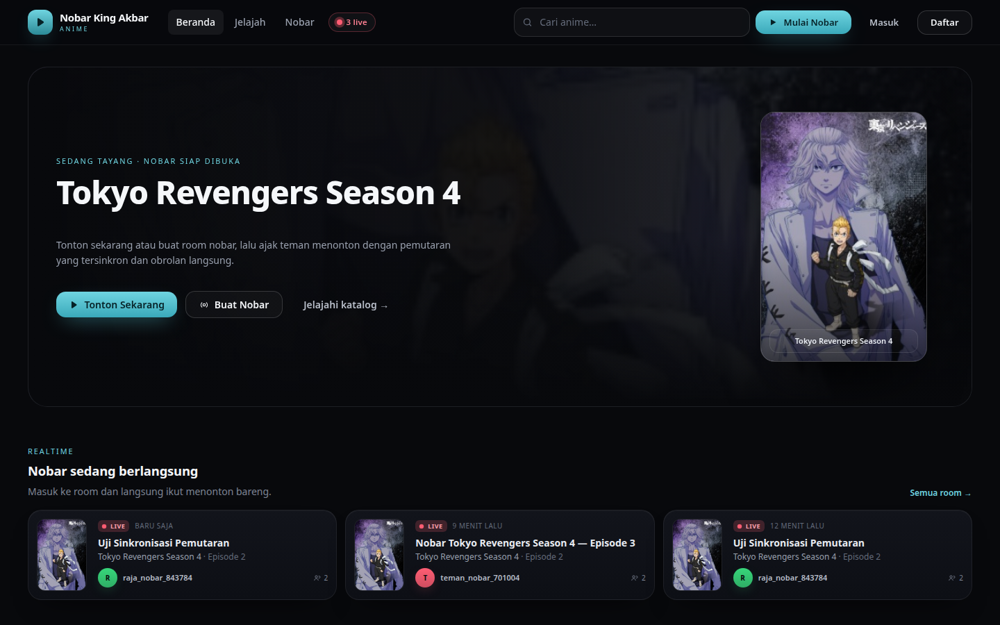 | 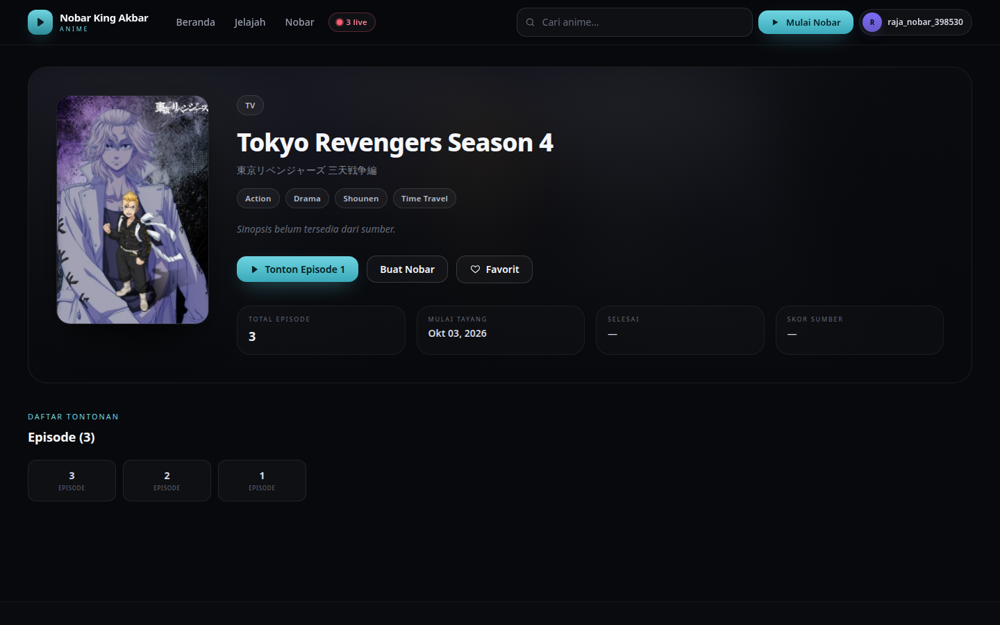 |

| Tonton (solo) | Room nobar (host) |
|---|---|
| 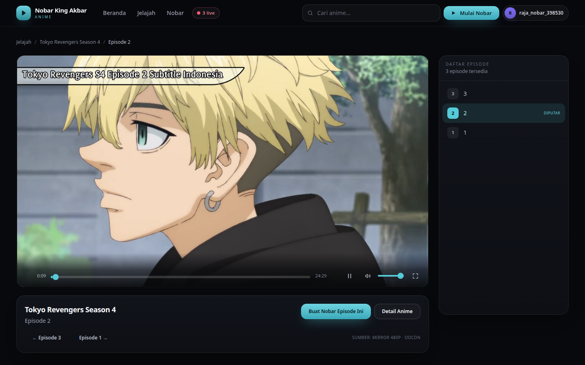 | 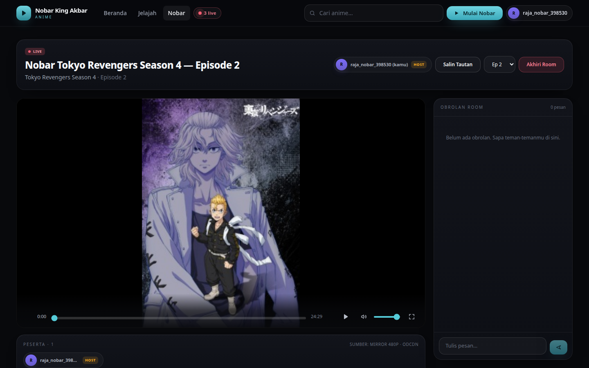 |

| Room nobar (peserta) | Profil |
|---|---|
| 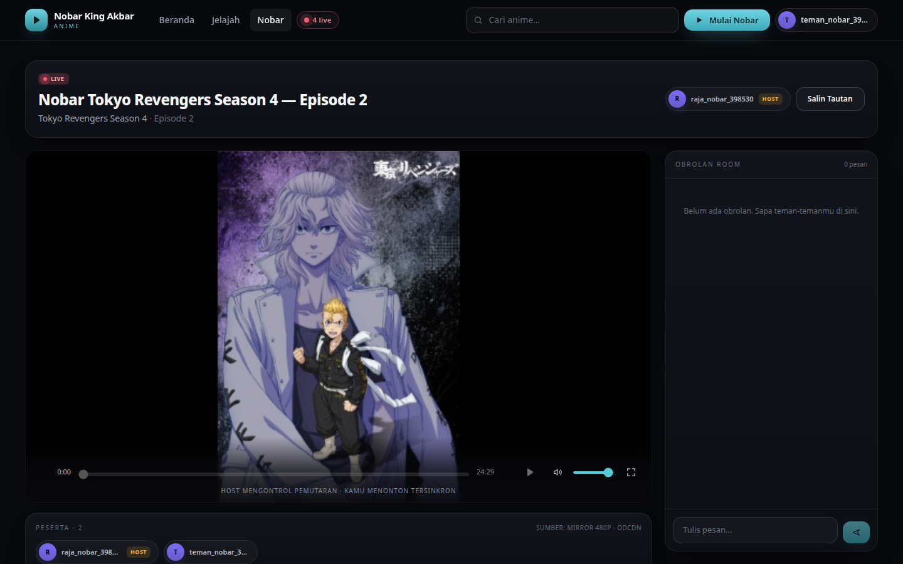 | 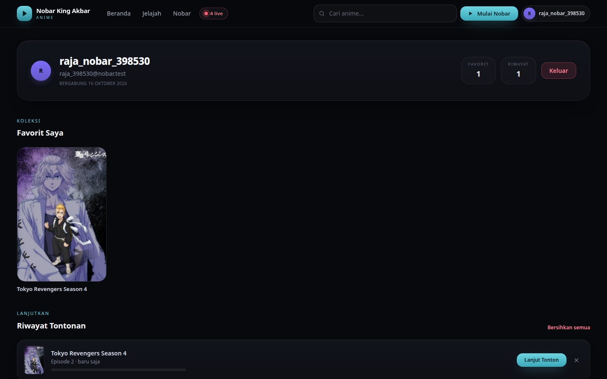 |

| Nobar berjalan — host | Nobar berjalan — peserta (tersinkron) |
|---|---|
| 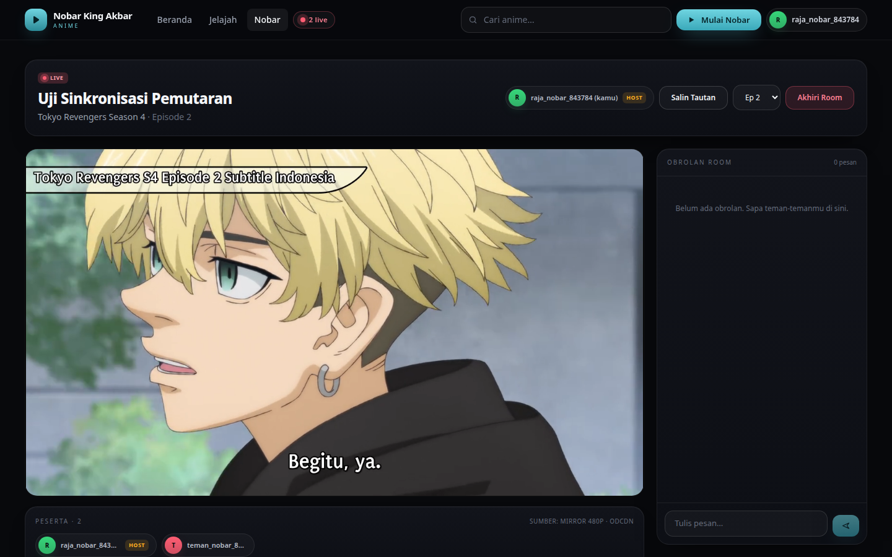 | 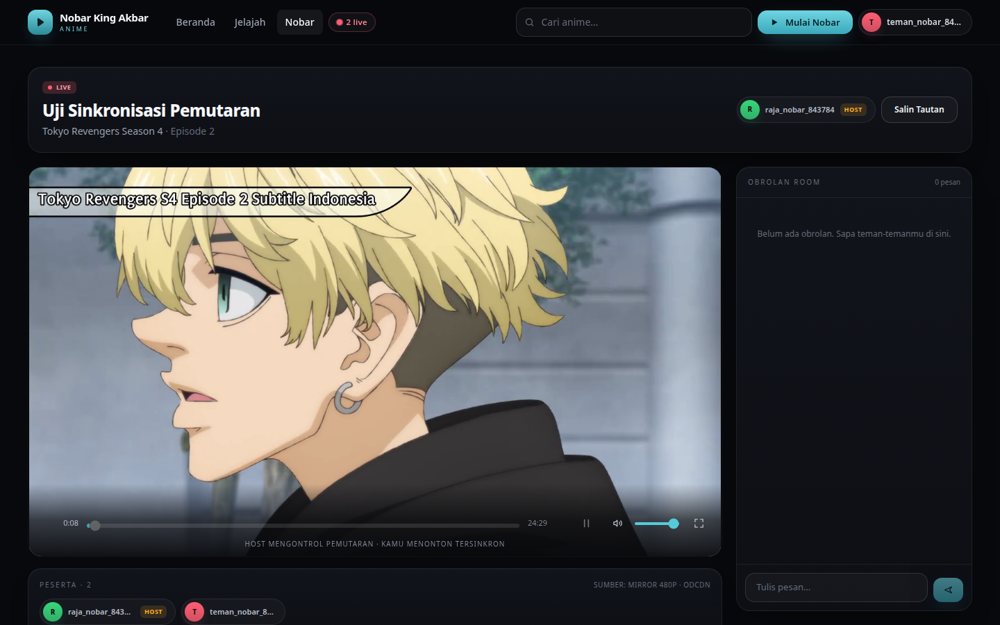 |

| Jelajah | Mobile |
|---|---|
| 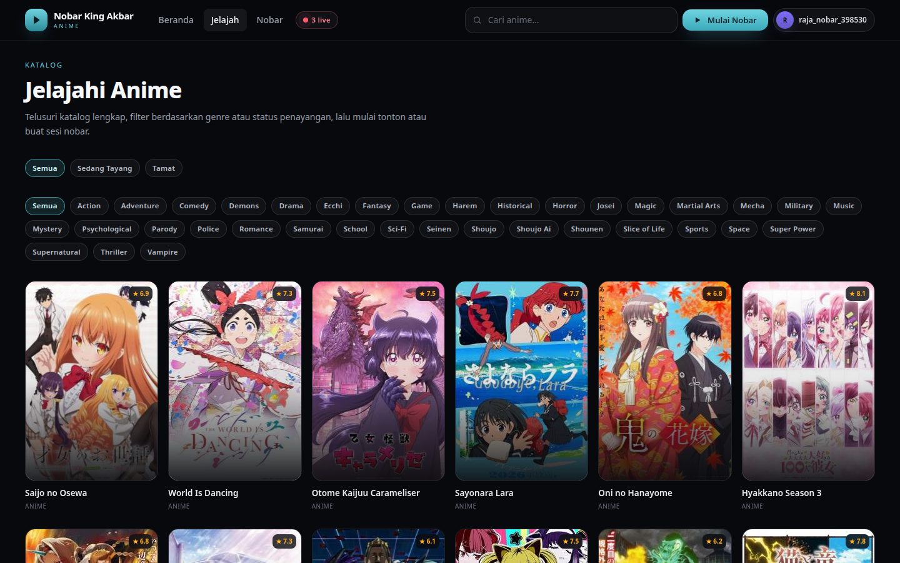 | 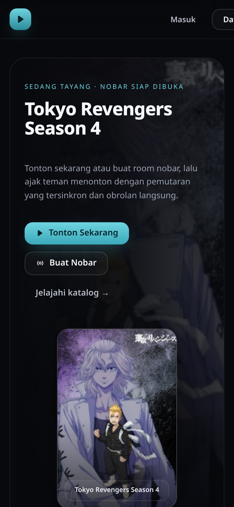 |

---

## Arsitektur

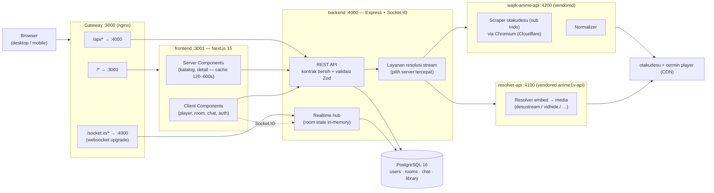

**Prinsip desain**

- **Satu origin untuk browser.** Browser selalu memanggil `/api/*` dan `/socket.io/*` di origin
  yang sama; gateway (nginx pada deployment, rewrites Next.js pada `next dev`) yang meneruskan
  ke backend. Tidak ada CORS di jalur browser, cookie sesi aman.
- **Kontrak bersih di backend.** Frontend tidak pernah menyentuh bentuk data mentah sumber.
  Adapter `wajik` menormalkan semuanya ke tipe internal (`AnimeCard`, `AnimeDetail`,
  `StreamSource`, dst.) dan **membuang data yang tidak valid alih-alih mengarang nilai**
  (contoh: status yang tidak dikenal → `null`, bukan tebakan).

> **Catatan sumber:** semua permintaan origin ke `wajik-anime-api` terisolasi di `wajik.client.ts` +
> `wajik.adapter.ts`; kontrak HTTP di bawah (dokumentasi, skema, respons) tidak menyebut entitas
> sumber mana pun, dan bila portabel ke sumber lain cukup satu adapter baru.
- **Realtime in-memory + persistensi selektif.** State pemutaran room hidup di memori
  (cepat, tanpa polling); pesan chat, peserta, dan metadata room dipersist ke PostgreSQL.
- **Resolver, bukan penebak.** URL stream diambil bertahap: daftar server episode → embed pilihan
  (prioritas `odcdn`/`odstream`/`ondesuhd`) → mesin resolver → diverifikasi (bukan `text/html`)
  → baru diberikan ke pemutar lewat proksi bertanda tangan.

---

## Struktur proyek

```
nobar-king-akbar-anime/
├── frontend/                 # Next.js 15 (App Router) — UI + SSR
│   ├── app/                  # rute: /, /explore, /anime/[id], /watch/[id]/[ep],
│   │                         #        /nobar, /nobar/create, /nobar/room/[roomId],
│   │                         #        /rooms, /login, /register, /profile
│   ├── components/           # anime · player · room · site · ui · providers · auth · watch
│   ├── hooks/useRoom.ts      # mesin state realtime room (socket + sync + chat)
│   ├── lib/                  # api client, tipe, format, socket singleton
│   └── Dockerfile
├── backend/                  # Express + TypeScript + Socket.IO
│   ├── src/
│   │   ├── adapters/wajik/   # klien + normalizer sumber otakudesu (satu-satunya yang tahu bentuk mentah)
│   │   ├── adapters/resolver/ # klien mesin resolver embed → URL media langsung
│   │   ├── controllers/ routes/ middleware/   # HTTP layer
│   │   ├── services/         # konten · auth · room · stream · statistik
│   │   ├── realtime/         # state room + event bus + hub Socket.IO
│   │   ├── repositories/     # SQL (users, rooms, library, content index)
│   │   └── database/         # pool + migrasi SQL versioned
│   ├── tests/                # unit test adapter (vitest)
│   └── Dockerfile
├── wajik-anime-api/          # sumber konten: scraper otakudesu (vendored, MIT) — lihat PATCHES.md
├── anime1v-api/              # mesin resolver embed (vendored, MIT) — lihat PATCHES.md
├── deploy/nginx.conf         # konfigurasi gateway untuk docker compose
├── docker-compose.yml        # postgres + wajik-anime-api + resolver-api + backend + frontend + gateway
└── docs/screenshots/         # bukti visual (diambil dari deployment yang berjalan)
```

---

## Menjalankan proyek

### Opsi A — Docker Compose (disarankan)

```bash
git clone <repo> nobar-king-akbar-anime && cd nobar-king-akbar-anime
docker compose up --build
# buka http://localhost:3000
```

> **Deploy permanen (24/7 di server sendiri):** ikuti
> [`deploy/DEPLOY.md`](deploy/DEPLOY.md) — Docker + `.env` produksi, auto-start systemd,
> domain & HTTPS, backup, dan pemantauan. Ringkasnya:
> `cp deploy/.env.production.example .env` → isi rahasia → `docker compose up -d --build`.

Compose menjalankan 6 layanan: `postgres`, `wajik-anime-api` (4200, internal — sumber konten),
`resolver-api` (4100, internal — mesin resolver embed), `backend` (4000), `frontend`
(3001, internal), dan `gateway` nginx (3000 → publik).

> Image `wajik-anime-api` memakai Chromium (Puppeteer) karena otakudesu dilindungi Cloudflare;
> build pertama mengunduh Chrome for Testing sehingga butuh waktu beberapa menit. Berikutnya
> semua katalog/stream diambil *per request* — daftar ongoing/completed dan episode baru
> otomatis mengikuti situs sumber, tanpa cron/mirror.

### Opsi B — Manual (4 terminal)

Prasyarat: Node.js 20+, PostgreSQL 14+.

```bash
# 0) database
createdb nobar_king   # atau lewat psql: CREATE DATABASE nobar_king;

# 1) sumber konten: wajik-anime-api (port 4200)
cd wajik-anime-api
npm install                   # mengunduh Chrome for Testing (sekali saja)
npm run build
PORT=4200 node dist/index.js  # atau: npm run dev

# 2) mesin resolver (port 4100) — dipakai untuk membuka URL embed player
cd ../anime1v-api
npm install
cp .env.example .env          # isi API_KEY, PORT=4100
node src/server.js

# 3) backend (port 4000) — migrasi berjalan otomatis saat boot
cd ../backend
npm install
cp .env.example .env          # sesuaikan DATABASE_URL, WAJIK_*, RESOLVER_*
npm run dev                   # tsx watch src/index.ts

# 4) frontend (port 3001)
cd ../frontend
npm install
cp .env.example .env.local    # INTERNAL_API_URL=http://127.0.0.1:4000
npm run dev -- -p 3001

# 5) gateway (port 3000) — opsional untuk dev, wajib untuk parity produksi
sudo cp deploy/nginx-local.conf /etc/nginx/sites-available/nobar
sudo ln -s /etc/nginx/sites-available/nobar /etc/nginx/sites-enabled/
sudo nginx -t && sudo nginx
```

> Tanpa gateway pun aplikasi tetap jalan di `http://localhost:3001` karena Next.js me-*rewrite*
> `/api/*` dan `/socket.io/*` ke backend.

---

## Konfigurasi

### backend/.env

| Variabel | Default | Keterangan |
|---|---|---|
| `PORT` | `4000` | Port HTTP backend |
| `DATABASE_URL` | `postgres://nobar:…@127.0.0.1:5432/nobar_king` | Koneksi PostgreSQL |
| `CORS_ORIGINS` | `http://localhost:3000,…` | Origin yang diizinkan (CSRF/rate guard) |
| `SESSION_COOKIE_NAME` / `SESSION_TTL_DAYS` | `nka_session` / `30` | Sesi login |
| `WAJIK_API_URL` | `http://127.0.0.1:4200` | Alamat wajik-anime-api (sumber konten, sub Indo) |
| `WAJIK_TIMEOUT_MS` / `WAJIK_CACHE_TTL` | `60000` / `300` | Timeout (browser fetch lebih lambat) & cache sumber (detik) |
| `RESOLVER_API_URL` | `http://127.0.0.1:4100/api/v1/anime` | Alamat mesin resolver embed |
| `RESOLVER_API_KEY` | — | API key internal ke mesin resolver |
| `RESOLVER_TIMEOUT_MS` | `120000` | Timeout resolusi embed (Puppeteer) |
| `STREAM_CACHE_TTL` | `600` | Cache resolusi stream (detik) |
| `STREAM_PROXY_SECRET` | `nobar-local-stream-proxy-secret` | Kunci HMAC proksi stream same-origin (ganti di produksi) |
| `RATE_LIMIT_*` | lihat `.env.example` | Batas laju per aksi (login, search, stream, …) |
| `ROOM_INACTIVE_CLEANUP_HOURS` | `12` | Room tanpa aktivitas ditutup otomatis |
| `MAX_ROOM_PARTICIPANTS` | `50` | Kapasitas peserta per room |

### frontend/.env.local

| Variabel | Default | Keterangan |
|---|---|---|
| `INTERNAL_API_URL` | `http://127.0.0.1:4000` | Dipakai SSR + rewrites (server-side) |
| `NEXT_PUBLIC_API_BASE` | *(kosong)* | Biarkan kosong = same-origin |
| `NEXT_PUBLIC_SOCKET_URL` | *(kosong)* | Biarkan kosong = same-origin |

---

## API backend

Semua respons memakai envelope konsisten:

```jsonc
// sukses
{ "status": "success", "data": …, "meta": { … } }
// error
{ "status": "error", "error": { "code": "ROOM_NOT_FOUND", "message": "…", "details": null }, "requestId": "…" }
```

| Method | Endpoint | Auth | Keterangan |
|---|---|---|---|
| GET | `/api/health` | — | Status layanan + DB |
| GET | `/api/meta/live-count` | — | Jumlah room live (untuk chip navbar) |
| GET | `/api/anime?page=&genre=` | — | Katalog (20/halaman) |
| GET | `/api/anime/search?q=` | — | Pencarian langsung ke sumber |
| GET | `/api/anime/ongoing?page=` | — | Sedang tayang |
| GET | `/api/anime/complete?page=` | — | Sudah tamat |
| GET | `/api/anime/trending` | — | Statistik internal (kosong jika belum ada aktivitas) |
| GET | `/api/anime/genres` | — | Daftar genre |
| GET | `/api/anime/:id` | — | Detail + daftar episode |
| GET | `/api/anime/:id/episodes` | — | Daftar episode saja |
| GET | `/api/anime/:id/episodes/:episodeId/stream` | — | **Resolusi server tercepat** (di-cache 5 menit) |
| GET | `/api/stream/proxy?u=&s=` | — | Proksi byte stream bertanda tangan (same-origin; playlist/segmen/rentang mp4). Hanya URL yang ditandatangani backend yang diterima |
| POST | `/api/auth/register` | — | Daftar (rate limit 5/jam/IP) |
| POST | `/api/auth/login` | — | Masuk (rate limit 10/15 menit/IP) |
| POST | `/api/auth/logout` | ✓ | Keluar |
| GET | `/api/auth/me` | ✓ | Profil sesi aktif |
| GET | `/api/rooms/live` | — | Room publik yang live |
| GET | `/api/rooms/mine` | ✓ | Room milikku (aktif + selesai) |
| POST | `/api/rooms` | ✓ | Buat room `{contentId, episodeId, roomName?, privacy?}` |
| GET | `/api/rooms/:id` | — | Detail room + peserta + state pemutaran |
| POST | `/api/rooms/:id/end` | ✓ | Akhiri room (host) |
| POST | `/api/rooms/:id/episode` | ✓ | Ganti episode room (host) |
| GET | `/api/rooms/:id/messages` | — | Riwayat chat (100 terakhir) |
| GET | `/api/me/favorites` | ✓ | Favorit |
| POST | `/api/me/favorites` | ✓ | Tambah favorit `{contentId}` |
| DELETE | `/api/me/favorites/:contentId` | ✓ | Hapus favorit |
| GET | `/api/me/history` | ✓ | Riwayat tontonan + progres |
| POST | `/api/me/history` | ✓ | Simpan progres `{contentId, episodeId, position, duration}` |
| DELETE | `/api/me/history/:contentId` | ✓ | Hapus satu riwayat |
| DELETE | `/api/me/history` | ✓ | Bersihkan semua riwayat |

Contoh:

```bash
# resolusi server tercepat untuk Naruto episode 1
curl "$BASE/api/anime/naruto/episodes/2623/stream" | jq '.data.picked'
# → { "type": "hls", "server": "hls", "url": "https://player.zilla-networks.com/m3u8/…", … }
```

---

## Realtime (Socket.IO)

Terhubung dengan cookie sesi (tanpa token terpisah). Satu koneksi per tab, di-*share* lewat
singleton `lib/socket.ts`.

### Klien → Server

| Event | Payload | Keterangan |
|---|---|---|
| `room:join` | `{ roomId }` | Bergabung (mengganti room bila sudah di room lain) |
| `room:leave` | — | Keluar |
| `player:play` | `{ position }` | Host: mulai putar pada detik tertentu |
| `player:pause` | `{ position }` | Host: jeda |
| `player:seek` | `{ position }` | Host: lompat ke detik tertentu |
| `player:episodeChange` | `{ episodeId }` | Host: ganti episode (validasi ke sumber) |
| `chat:message` | `{ message }` | Kirim chat (≤500 karakter, 30/menit) |
| `room:end` | — | Host: akhiri room |

### Server → Klien

| Event | Payload | Keterangan |
|---|---|---|
| `room:joined` | `{ room }` | Konfirmasi + data room |
| `room:update` | `{ participants, participantCount }` | Presence berubah |
| `player:sync` | `{ isPlaying, position, updatedAt, episodeId, serverTime }` | State otoritatif untuk sinkronisasi |
| `chat:message` | `ChatMessage` | Pesan baru (termasuk echo ke pengirim) |
| `chat:history` | `ChatMessage[]` | Riwayat saat bergabung |
| `room:episode` | `{ episode }` | Episode room berubah |
| `room:end` | — | Room berakhir |
| `room:error` | `{ code, message }` | Mis. `NOT_ROOM_HOST`, `ROOM_ENDED`, `CHAT_RATE_LIMITED` |

**Algoritma sinkronisasi (klien peserta):** pada setiap `player:sync`, jika `|posisi_video −
posisi_target| > 1,6 dtk` → lompat ke posisi target; jika status putar berbeda → play/pause.
Host tidak pernah "ditarik" oleh sync (dialah sumbernya), sehingga tidak ada loop umpan balik.

---

## Basis data

PostgreSQL, migrasi versioned (`backend/src/database/migrations/`, dijalankan otomatis saat boot).

| Tabel | Isi |
|---|---|
| `users` | akun (username, email unik, hash kata sandi, warna avatar) |
| `sessions` | sesi login (token **di-hash**, kedaluwarsa, last seen) |
| `content_index` | indeks konten yang pernah dilihat (slug → URL sumber) — agar favorit/riwayat/room bisa menampilkan poster tanpa memanggil sumber |
| `rooms` | room nobar (host, konten, episode, privasi, aktif, state pemutaran) |
| `room_participants` | keanggotaan room |
| `room_messages` | chat room |
| `favorites` | favorit per pengguna |
| `watch_history` | riwayat + posisi menonton (unique per pengguna+konten) |

---

## Sumber data & resolusi stream

- Data katalog, detail, dan daftar server episode berasal dari **wajik-anime-api** yang di-*vendor*
  ke repo ini (MIT, dari [wajik45/wajik-anime-api](https://github.com/wajik45/wajik-anime-api)),
  scraper **otakudesu (sub Indo)**. Karena otakudesu dilindungi Cloudflare, seluruh permintaan
  halaman dijalankan lewat Chromium hangat (`browserFetch`) — lihat
  [`wajik-anime-api/PATCHES.md`](wajik-anime-api/PATCHES.md).
- **Update anime berjalan otomatis:** tidak ada mirror/cron. Setiap kunjungan memicu scrape
  *live* ke situs sumber (halaman ongoing/completed/pencarian/detail), lalu backend
  meng-cache hasilnya `WAJIK_CACHE_TTL` detik. Episode baru muncul begitu sumber menerbitkannya.
- Endpoint `/api/anime/:id/episodes/:episodeId/stream` menjalankan rantai: daftar server episode →
  kandidat embed berprioritas (`odcdn` > `odstream` > `ondesuhd` > …) → URL embed →
  **resolver-api** (Puppeteer) mengubah embed menjadi URL media langsung → verifikasi (bukan
  `text/html`) → proksi bertanda tangan. Hasil di-cache `STREAM_CACHE_TTL` detik.
- **Proksi stream bertanda tangan.** CDN sumber umumnya tidak mengirim header CORS (dan
  sebagian memeriksa metadata `Sec-Fetch-*`), sehingga browser tidak bisa menarik byte-nya
  langsung. Backend menyediakan `/api/stream/proxy` yang meneruskan byte **tanpa menyimpan
  apa pun**; playlist yang lewat proksi ditulis ulang sehingga semua segmen tetap melalui
  origin kita, dan hanya URL ber-HMAC sah yang diterima (bukan open proxy).
- Jika sumber tidak menyediakan nilai (mis. status judul), API mengembalikan `null` — UI
  menampilkan apa adanya, bukan data karangan.

---

## Pengujian

```bash
# unit test adapter backend (normalisasi sumber, peringkat kandidat server, parsing URL)
cd backend && npx vitest run          # 16 test

# typecheck
cd backend && npx tsc --noEmit
cd frontend && npx tsc --noEmit

# build produksi frontend
cd frontend && npm run build
```

Verifikasi end-to-end yang dipakai selama pengembangan (butuh stack berjalan; jalankan
`npm install` di `wajik-anime-api` dan `anime1v-api` dulu karena skrip memakai Chromium
Puppeteer dari sana):

| Skrip | Cakupan |
|---|---|
| `scripts/realtime-check.js <ROOM_ID> <HOST_COOKIE> [BASE]` | 11 skenario Socket.IO: join, presence, sync play/pause/seek, chat dua arah, penolakan kendali non-host, room berakhir (11/11 lulus) |
| `scripts/playback-check.js` | Pemutaran nyata di halaman tonton: metadata, `currentTime` berjalan, frame ter-decode (`videoWidth > 0`, terukur 1280×720) |
| `scripts/room-playback-check.js` | Room dua akun: pemutaran nyata host + peserta, drift < 3 dtk (terukur 0,00–1,4 dtk), propagasi jeda |
| `scripts/e2e-screenshots.js` | Walkthrough visual penuh (20 tangkapan layar) — atur `E2E_BASE` ke origin Anda |

```bash
node scripts/realtime-check.js <roomId> <nobarSessionCookie> http://localhost:4000
E2E_BASE=http://localhost:3000 node scripts/playback-check.js
```

---

## Keamanan

- Kata sandi di-hash **bcrypt**; token sesi disimpan **di-hash (SHA-256)**, cookie
  `HttpOnly` + `SameSite=Lax`.
- Rate limit per IP untuk login/registrasi/pencarian/stream/pembuatan room, dan per pengguna
  untuk chat (30 pesan/menit).
- Validasi input **Zod** di seluruh endpoint; pesan error berbahasa Indonesia dengan kode
  mesin (`EPISODE_NOT_FOUND`, `NOT_ROOM_HOST`, …).
- `helmet` + origin guard untuk permintaan lintas situs; tidak ada data sensitif yang
  dikirim ke klien.
- Room privat tidak pernah muncul di daftar publik.

---

## Batasan

- **Realtime bersifat single-instance** (state room di memori satu proses). Untuk skala
  multi-node diperlukan adapter Socket.IO + Redis — di luar cakupan versi ini.
- Ketersediaan stream bergantung penuh pada server sumber; resolver bisa gagal sesaat dan
  UI menampilkan opsi coba lagi / ganti episode.
- Karena halaman sumber diambil lewat Chromium, permintaan pertama ke sebuah halaman bisa
  terasa lebih lambat (± 3–8 detik) sebelum cache menghangat; kegagalan Cloudflare tetap
  ditampilkan sebagai error yang jujur, bukan daftar kosong palsu.
- Progres tontonan disimpan tiap ~5 detik saat video berjalan (bukan realtime per detik).
- `npm run build` frontend menggunakan Turbopack; bila lingkungan Anda bermasalah dengan
  Turbopack, gunakan `npx next build` (webpack).

---

## Kredit

- Sumber data: [wajik45/wajik-anime-api](https://github.com/wajik45/wajik-anime-api) (MIT) —
  scraper otakudesu (sub Indo), dimodifikasi; lihat `wajik-anime-api/PATCHES.md`.
- Mesin resolver embed: [FxxMorgan/anime1v-api](https://github.com/FxxMorgan/anime1v-api) (MIT) —
  dimodifikasi; lihat `anime1v-api/PATCHES.md`.
- Data katalog & stream berasal dari situs publik otakudesu beserta cermin playernya;
  proyek ini hanya menampilkan ulang apa yang sumber sediakan untuk permintaan pengguna.
- Ikon antarmuka: SVG inline buatan sendiri (tanpa dependensi ikon eksternal).
- Dibuat untuk komunitas nobar. Seluruh merek dan konten milik pemegang haknya masing-masing.
